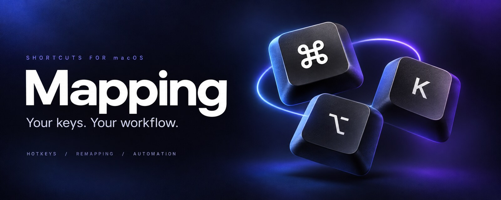

<p align="center">
  
</p>

<h1 align="center">Mapping</h1>

<p align="center">
  把常用操作，交给顺手的快捷键。<br>
  macOS 菜单栏工具，管理快捷键、按键映射和自动动作。
</p>

<p align="center">
  <a href="https://github.com/o98k-ok/mapping/releases/latest"><strong>下载 DMG</strong></a>
  &nbsp; · &nbsp;
  <a href="#开始使用">开始使用</a>
  &nbsp; · &nbsp;
  <a href="#配置与构建">配置与构建</a>
</p>

<p align="center">
  <sub>macOS 14+ &nbsp; / &nbsp; Apple Silicon & Intel &nbsp; / &nbsp; 中文 & English &nbsp; / &nbsp; SwiftUI</sub>
</p>

---

## 少点几次，多做一点

| 你想做的事 | Mapping 来完成 |
| :--- | :--- |
| **一键打开应用** | 设置全局快捷键，比如按下 `⌥ G` 打开 Safari。 |
| **换成习惯的按键** | 为指定应用重映射快捷键，不影响其他应用。 |
| **切换应用时自动执行** | 应用进入前台时运行脚本或发送按键，比如通过脚本切换输入法。 |
| **把几步操作连起来** | 组合打开应用、发送按键、执行脚本和延迟动作。 |
| **定时检查状态** | 用脚本读取状态，与期望值不符时执行动作。 |

点击菜单栏 **⌘**，就能录制快捷键、编辑分组和开关规则。支持颜色与图标分组、使用次数统计，以及深色、浅色和跟随系统主题。

## 开始使用

1. 从 **[最新 Release](https://github.com/o98k-ok/mapping/releases/latest)** 下载 DMG，将 Mapping 拖入 Applications。
2. 打开应用，在 **系统设置 → 隐私与安全 → 辅助功能** 中授权 Mapping。
3. 点击菜单栏 **⌘**，新建分组，添加映射，录制快捷键并选择动作。

底部的地球菜单可切换 **中文 / English**，选择会自动保存。默认中文，已有分组名、映射名和脚本不会被翻译。

> **首次打开提示**：当前发布包使用自签名，未经过 Apple 公证。若被系统拦截，请在「系统设置 → 隐私与安全」中确认允许打开。升级后可能需要重新授予辅助功能权限。

## 配置与构建

日常设置可直接在界面中完成。配置保存在 `~/.config/mapping/config.json`，手动编辑后点击面板底部的重新加载按钮。

<details>
<summary><strong>从源码构建</strong></summary>

需要 Xcode 16+ 和 XcodeGen。

```bash
brew install xcodegen
git clone https://github.com/o98k-ok/mapping.git
cd mapping
./build.sh --run
```

只构建可运行 `./build.sh`，安装到 Applications 可运行 `./build.sh --install`。

</details>

<details>
<summary><strong>配置格式与动作参考</strong></summary>

顶层 `language` 可设为 `en` 或 `zh-Hans`，未配置时默认中文。

### 配置结构

下面展示主要字段，完整示例见 [DefaultConfig.json](Mapping/Resources/DefaultConfig.json)。

```json
{
  "groups": [
    {
      "name": "分组名称",
      "color": "#5B8DEF",
      "icon": "keyboard",
      "isEnabled": true,
      "bundleIdentifiers": ["com.example.app"],
      "mappings": []
    }
  ]
}
```

### 触发方式

| 类型 | 说明 | 示例 |
|------|------|------|
| `hotkey` | 按下快捷键触发 | `{"type": "hotkey", "key": "g", "modifiers": ["option"]}` |
| `appActivation` | 应用切换到前台时触发 | `{"type": "appActivation"}` |
| `stateWatch` | 每隔 `intervalSeconds` 秒运行 `stateScript` 取当前状态（取其 stdout），与 `expectedState` 不符时执行动作。分组限定了应用时只在那些应用在前台时守护，全局分组则全局守护。间隔、脚本、期望三项缺一或脚本失败时跳过、不执行 | `{"type": "stateWatch", "intervalSeconds": 3, "stateScript": "im-select", "expectedState": "com.baidu.inputmethod.BaiduIM.pinyin"}` |

### 动作类型

| 类型 | 说明 | 参数 |
|------|------|------|
| `openApp` | 打开/切换到应用 | `bundleId`, `appName` |
| `sendKeyCombo` | 模拟按键组合 | `key`, `modifiers` |
| `runShellScript` | 执行 Shell 脚本 | `script` |
| `delay` | 延迟等待 | `delayMs`（毫秒） |

### 修饰键

`command` `option` `control` `shift`

### 配置示例

```json
{
  "name": "Block切换1",
  "trigger": { "type": "hotkey", "key": "1", "modifiers": ["command"] },
  "actions": [
    { "type": "sendKeyCombo", "key": "1", "modifiers": ["control", "shift"] },
    { "type": "delay", "delayMs": 50 },
    { "type": "sendKeyCombo", "key": "m", "modifiers": ["command"] }
  ]
}
```

</details>

---

<p align="center">
  <sub>用 Swift 与 SwiftUI 构建 · MIT License</sub>
</p>
